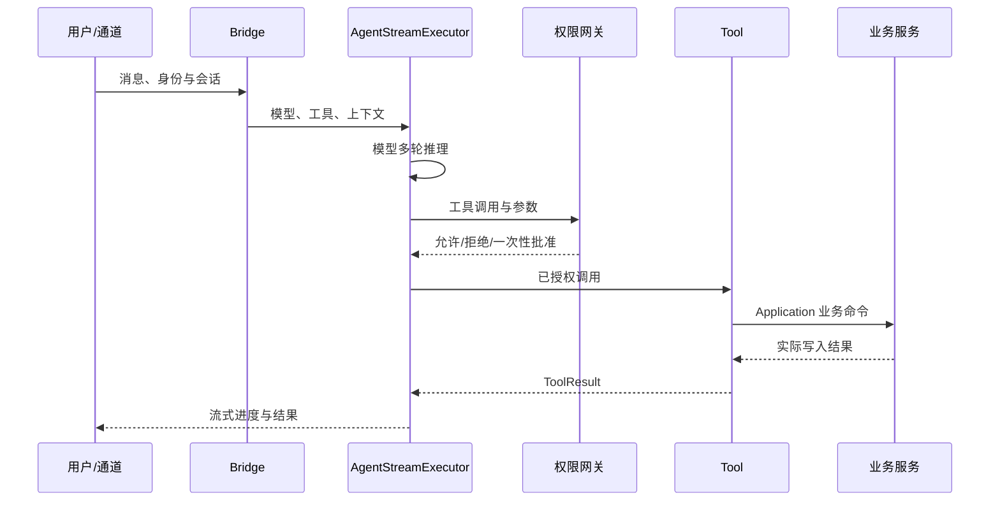

# Agent / Harness 当前运行机制

消息由 `channel/` 或桌面/Web 进入 `bridge/`。Bridge 选择 Agent 配置、模型、工具和会话，再调用 `agent/protocol/agent_stream.py` 的多轮流式执行器。执行器建立上下文、发送模型请求、解析工具调用、流式返回进度，并将结果写入会话。`agent/protocol/message_utils.py` 负责消息结构和压缩；`agent/memory/conversation_store.py` 保存会话、消息及运行准入记录。

工具声明在 `agent/tools/`。模型建议调用后，`agent/runtime/tool_invocation.py` 在执行时校验权限，`agent/permission/gateway.py` 根据身份、会话、项目根和动作类型允许、拒绝或请求一次性批准；工具本身仍需验证输入。`agent/tools/base_tool.py` 是工具结果和可用性的共同接口。调用业务时优先进入 `Application.port` 或 `Application.command`，避免把业务规则写在模型提示词或工具适配器中。

取消和失败路径见 `agent/protocol/cancel.py`、`agent/runtime/run_record.py` 与对应 `tests/test_harness_runtime.py`、`tests/test_security_approval_resume.py`。模拟模型测试只能证明控制流；真实模型行为须单独评测并记录成本与外部依赖。
