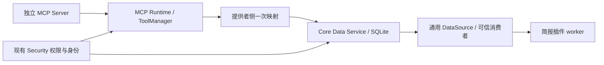

# 数据服务

2026-10-21。方向：已确认；契约：首阶段已实现；验收状态见当前开发任务。本文描述 Core 数据采集与分发边界，不代表已接入全部业务来源。

Data Service 让同一来源被多个获授权消费者复用。登录、IMAP 和学校抓取属于独立 MCP；摘要、评分和事务判断属于业务插件。Core 只管理来源、记录、同步检查点及可靠变更通知。

## 数据流与入口

实现入口是 `core/data/{runtime,providers,service,store}.py`。`ProviderRegistry.register` 接受受信宿主的 `discover/authorize/fetch` 实现；`McpProvider` 复用唯一 ToolManager，不创建第二个 MCP Client。`EMAIL_MAPPING` 是首个生产映射。第三方 Server 可声明不同发现字段、记录字段和工具名；`cursor_argument` 可省略或改名，`cursor_key` 将标量游标映射到内部检查点。消费者只使用 `FetchedItem/FetchResult` 信封。

用户级 `data/data.db` 存放来源、记录、同步状态、事件、订阅和投递状态。既有账号、凭据、邮件与简报数据库、游标和已下载文件不迁移、不清空。来源保存 `enabled` 用户意图及独立 `present` 发现状态：仅完整成功的发现可撤下消失来源，恢复后仍保留原配置与缓存，发现拒绝不等于删除。

## 一致性与事件

记录稳定键由来源实例、账号和上游标识确定。记录变更、通知及采集游标在同一 SQLite 事务提交；部分采集失败保留旧游标，重试去重。跨进程同步租约防止重复并行采集。引用、缓存和持久化策略分别支持移除正文、保留期限和长期保存；清理只影响 Data Service 自己的数据。

事件是**变更通知**。`type` 和 `version` 描述触发变化，`record` 是交付时重新授权的当前状态，`record_version` 是当前版本，`content_semantics` 固定为 `current-state`。删除通知的 `record` 始终为空，即使原始记录后来重新同步；不会保留可在隐私删除后重放的历史正文。当前状态不再匹配订阅过滤时跳过并确认该通知；历史回放每条记录只排最新通知。需要不可变历史的消费者须自行保存获准的业务快照。

每个订阅有独立投递记录和租约。队首正在处理或失败时，后续通知不能越过；异常保留次数和原因，可显式重试，过期租约可恢复。消费者须按稳定事件 ID 幂等处理。已登记的 Core 简报消费者通过真正插件 RPC 保存来源项，不在数据服务处理摘要。

## 权限与界面

Data Service 不保存第二套 ACL。查询、同步、导出、删除及交付通过当前 Security/Tool/MCP 权限；读取缓存也不能绕过连接停用、工具开关、旧 Grant 撤销或资源范围。服务实例绑定用户，仍按当前工作区和真实调用者执行。可信 `Consumer` 注册可以绑定插件消费者身份，订阅标签不能授予权限；已有消费者上下文不能被替换。读取正文后再次检查权限、来源 revision 和订阅状态。

主侧边栏「数据管理」负责来源、记录、同步分发与存储，API 为 `/api/data`、`/api/data/records`、`/api/data/command`。账号与 MCP 配置跳转既有入口。安全中心「数据访问」保留连接、资源及外传策略，显示并编辑迁移前授权（沿用原授权库，原生用户操作、所有权及 revision 校验）。安全活动清理仍归安全中心。

## 验证与阶段范围

`tests/test_data_service.py` 验证事务、去重、策略、身份及并发；`test_data_mcp_integration.py` 验证独立 stdio SDK、不同字段/标量游标映射和真实简报 worker；`test_data_api.py` 与 `test_mcp_access_management.py` 验证原生授权边界；`ui_data_management.py` 验证实际浏览器操作。

当前使用手动及既有简报调度触发采集；动态第三方插件注册声明与自动清理调度是后续范围。分页目前扫描来源记录再切片，大邮箱的有界 SQL 查询属于已知性能改进项。
