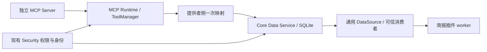

# 数据服务

2026-10-22。方向与实施范围由用户确认；本文记录当前实现。数据页已接入邮箱、eLearning、授权工作区、事务、日程、账单、简报、知识和记忆，采用采集记录与所有者资源引用两种机制。验证入口见文末。

Data Service 让同一来源被多个获授权消费者复用。登录、IMAP 和学校抓取属于独立 MCP；摘要、评分和事务判断属于业务插件。Core 只管理来源、记录、同步检查点及可靠变更通知。

## 数据流与入口

实现入口是 `core/data/{runtime,providers,service,store}.py`。`ProviderRegistry.register` 接受受信宿主的 `discover/authorize/fetch` 实现；`McpProvider` 复用唯一 ToolManager，不创建第二个 MCP Client。`EMAIL_MAPPING` 是首个生产映射。第三方 Server 可声明不同发现字段、记录字段和工具名；`cursor_argument` 可省略或改名，`cursor_key` 将标量游标映射到内部检查点。消费者只使用 `FetchedItem/FetchResult` 信封。

用户级 `data/data.db` 存放来源、记录、同步状态、事件、订阅和投递状态。既有账号、凭据、邮件与简报数据库、游标和已下载文件不迁移、不清空。来源保存 `enabled` 用户意图及独立 `present` 发现状态：仅完整成功的发现可撤下消失来源，恢复后仍保留原配置与缓存，发现拒绝不等于删除。

## 一致性与事件

记录稳定键由来源实例、账号和上游标识确定。记录变更、通知及采集游标在同一 SQLite 事务提交；部分采集失败保留旧游标，重试去重。跨进程同步租约防止重复并行采集。引用、缓存和持久化策略分别支持移除正文、保留期限和长期保存；清理只影响 Data Service 自己的数据。

事件是**变更通知**。`type` 和 `version` 描述触发变化，`record` 是交付时重新授权的当前状态，`record_version` 是当前版本，`content_semantics` 固定为 `current-state`。删除通知的 `record` 始终为空，即使原始记录后来重新同步；不会保留可在隐私删除后重放的历史正文。当前状态不再匹配订阅过滤时跳过并确认该通知；历史回放每条记录只排最新通知。需要不可变历史的消费者须自行保存获准的业务快照。

每个订阅有独立投递记录和租约。队首正在处理或失败时，后续通知不能越过；异常保留次数和原因，可显式重试，过期租约可恢复。消费者须按稳定事件 ID 幂等处理。已登记的 Core 简报消费者通过真正插件 RPC 保存来源项，不在数据服务处理摘要。

## 权限与界面

Data Service 不保存第二套 ACL。查询、同步、导出、删除及交付通过当前 Security/Tool/MCP 权限；读取缓存也不能绕过连接停用、工具开关、旧 Grant 撤销或资源范围。服务实例绑定用户，仍按当前工作区和真实调用者执行。可信 `Consumer` 注册可以绑定插件消费者身份，订阅标签不能授予权限；已有消费者上下文不能被替换。读取正文后再次检查权限、来源 revision 和订阅状态。

主侧边栏「数据」默认进入资源浏览，来源、同步分发和存储是辅助视图。原生 API 包括 `/api/data`、`/api/data/resources`、兼容的 `/api/data/records` 和 `/api/data/command`。邮箱及 eLearning 的账号、课程选择与保存目录表单集中于 `/data/sources/email`、`/data/sources/elearning`；旧 `/email`、`/elearning` 兼容跳转。安全中心「数据访问」保留连接、资源及外传策略，显示并编辑迁移前授权（沿用原授权库，原生用户操作、所有权及 revision 校验）。数据页没有独立授权表单，来源启用只表示在数据服务中使用该来源。

## 验证与阶段范围

`tests/test_data_service.py` 验证事务、去重、策略、身份及并发；`test_data_mcp_integration.py` 验证独立 stdio SDK、不同字段/标量游标映射和真实简报 worker；`test_data_api.py` 与 `test_mcp_access_management.py` 验证原生授权边界；`ui_data_management.py` 验证实际浏览器操作。

当前使用手动及既有简报调度触发采集；动态第三方插件注册声明与自动清理调度是后续范围。分页目前扫描来源记录再切片，大邮箱的有界 SQL 查询属于已知性能改进项。

## Provider / Source / Resource

2026-10-21 的扩展在原采集链路旁增加资源目录，不搬迁业务库。`ProviderRegistry` 接受两种可信提供者：`discover/authorize/fetch` 采集型，或 `discover/authorize/resources/read_resource` 引用型；提供者只由宿主注册，公开 callback 不能注册任意代码。`descriptors()` 描述机制和支持的操作。

Source 是稳定来源实例，必须有 `id/name/kind`，可声明 `operations`；仅采集型来源要求已有账号绑定。引用型来源不伪造邮箱账号、时间和正文，只支持自身声明的操作。来源的 enabled、present、revision 与用户存储意图继续分离。一次提供者发现中的身份冲突、重复或无效项使整个批次回滚，成功发现才更新 present，不会留下半个来源目录。

`core/data/resources.py::Resource` 是冻结引用：`id/source_id/provider/reference/kind/name/operations`。ID 由 provider、source 与 reference 稳定派生。新增 SQLite `resources` 表仅缓存这些引用元数据，原 `records/events/sync_state` 格式与稳定 ID 不变。资源目录只表示已发现的引用，不表示已授权读取、已缓存正文或已加入模型上下文。

`DataService.resources(source_id, query='', limit=50, offset=0, kind=None)` 返回资源页，类型过滤先于最终分页；`read_resource(source_id, resource_id)` 只接受已登记的资源。引用型所有者收到 Core 验证的 Resource 信封，负责实时解析引用和资源级授权，返回 `{resource, content}`。可选 `authorize_resource` 在读取前后复查具体方法和资源的权限。Core 校验返回的来源、资源身份、当前权限、来源 revision、启停和取消。旧采集记录自动适配成资源，原记录接口及邮箱→简报订阅继续工作；引用型来源不会出现同步、订阅、导出或缓存清理等未实现动作。

内置 `WorkspaceProvider` 将当前会话/任务的工作文件作为引用来源，使用 Workspace Service 的路径约束和 Security Service 的逐文件权限，不收集其他会话目录、凭据、托管插件私有数据或符号链接。无会话/任务的后台宿主不会默认登记包含所有私有会话的 Work 父目录。工作区扫描有界，超过 20,000 文件会明确拒绝，文本读取上限沿用 Workspace Service；本阶段没有后台全盘索引器。

HTTP 新增 `/api/data/resources`：传 source_id 返回目录页，另传 resource_id 执行按需读取；两种请求均要求原生 API 认证。数据页按来源声明展示可执行动作，引用来源按需查看内容；旧采集记录保留原操作。插件通过 `stella.data@1` 的只读方法消费资源，必须声明并获准 `data.read`，授权消费者和用途沿原调用传递。来源注册、存储清理和 Security 管理不在插件公开契约中。

## 已接入的所有者

`core/data/runtime.py::current_service` 注册以下实际适配器。业务正文由原所有者读取，不通过原始 SQLite 路径绕过插件或 MCP。

| 信息源 | 所有者与实际调用 | 数据服务保存的内容 |
| --- | --- | --- |
| 邮箱 | `McpProvider` 经同一 ToolManager 调用 `list_sources/fetch_messages` | 原有采集记录、游标、事件和订阅 |
| eLearning | `ElearningProvider` 经同一托管 MCP 调用 `get_settings/list_courses/fetch/list_files` | 账号绑定的来源及课程、公告、作业、测试、成绩、文件引用 |
| 工作区 | `WorkspaceProvider` 经 Workspace/Security Service 浏览和读取当前范围文件 | 与 Agent、会话或任务、当前根目录绑定的文件引用 |
| 事务、日程、账单、简报 | `PluginResourceProvider` 调用各自已有的列表和详情契约 | 原业务 ID 的资源引用 |
| 知识、记忆 | 同一适配器调用 `list_tree/read_file`、`list_files/get_content` | 文档路径、类别及来源引用；不复制编辑器或索引 |

插件适配器与原 gateway 共用序列化锁、用户句柄、生命周期租约及现有 Grant。`PluginSession.invoke_contract(check_only=True)` 只允许经过完整授权的 query，用于查询和结果释放前的权限检查；它不执行目标业务方法，也不向插件 callback 开放。

eLearning 的目录按课程和方法分别检查权限，未授权课程或文件方法不会阻断其他已授权资源；完全没有可读取资源权限时明确拒绝。历史课程内容通过原 Server 的查询窗口读取，文件由原 Server 提供元数据和上游链接，不将二进制伪装成正文。查看目录不推进简报消费游标，也不自动缓存正文、建立知识索引或加入模型上下文。简报继续使用同一 MCP 的既有后台消费接口，保留独立游标与现有历史数据。

课程文件同步是来源所有者的真实操作，入口为数据页的 eLearning 配置区。`POST /api/data/elearning/sync-files` 经 `DataController.owner_operation` 选择唯一且仍存在的来源，再由 `DataService.owner_operation` 检查启用状态、账号、操作白名单和调用后的来源 revision；停用或配置变化时拒绝返回成功结果。接口严格转发现有 `sync_files` 参数，拒绝路径和身份注入；目录、课程范围、文件写权限、下载 manifest、防覆盖及重复执行仍由现有 MCP 与 Security 校验。用户必须先保存目录，界面才允许按需同步；修改过的本地文件保留。该操作与 Core 采集记录的同步、缓存清理和上游删除分开，没有新增自动下载任务或授权开关。

## 原生浏览范围与验证

`core/data/native.py::browse_scope` 从认证后的原生请求选择已登记且启用的 Agent 与会话，不接受任意工作目录。无绑定执行上下文时建立 UI 上下文；已经存在的工具、任务或插件上下文只能保留自身范围，不能借原生接口改变身份或升级来源。范围变化后重新发现工作区来源，旧工作区的引用不能在新范围读取。界面提供当前会话及所选 Agent 最近 200 个会话，空会话范围仅浏览用户信息源。

资源浏览支持来源、类型和 Agent/工作区选择，跳转来源时保留范围。切换范围、刷新、读取失败和重新获得窗口焦点会清除旧正文或重新授权。来源卡片分别展示服务可用性、读取时授权和同步状态；这些状态不代表当前模型已获得内容。

新增验收入口为 `tests/test_owned_resource_providers.py`（真实插件 RPC、撤销、消费者和后台范围）、`test_data_elearning_resources.py`（真实独立 MCP、部分课程授权、账号变化、下载与本地编辑保护）、`test_data_browse_scope.py`（类型分页和跨工作区 HTTP 拒绝）、`test_mcp_execution_budget.py`（锁、取消、流式 HTTP 总时限）。`ui_data_management.py`、`ui_elearning_settings.py` 验证资源默认页、筛选、失败反馈、来源配置和桌面/窄窗口交互。

插件 manifest 动态声明提供者与自动清理调度仍不在当前实现中；宿主可注册具备上述契约的可信适配器。引用列表与类型过滤仍可能扫描所有者的完整目录，大规模来源的索引和服务端分页属于性能限制，不改变当前授权边界。
