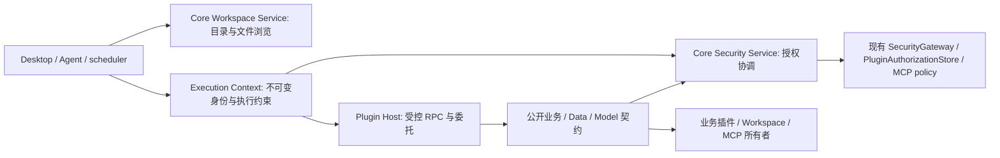

# 工作区、执行上下文与服务授权

2026-10-21。讨论与决策：本次用户明确要求实施的服务边界已确认；实现：已接入工具、插件、子 Agent 与模型路径。本文描述当前代码；验收证据随本次任务维护，不用历史测试数代替当前验收。

Stella 的一次工作必须始终能回答：为谁执行、属于哪个 Agent 与会话、在哪里读写、是交互还是后台任务，以及代表哪个插件消费者。工作目录与交付对话不是同一个概念，资源目录也不是授权清单。

## 当前结构与职责

下图为当前 Core 组件视图，箭头表示调用或约束，不表示独立进程；插件 worker 与 MCP Server 仍是独立进程。

`core/workspace/service.py::WorkspaceService` 统一文件浏览、上下文解析和受管执行工作副本分配。Desktop、Agent Bridge、工具权限、浏览器文件检查、shell 隔离和 Agent Hub 使用这一入口。`agent/workspace/service.py` 保留旧导入；`agent/workspace/context.py` 仍为布局兼容适配器，`common/state_dir.py` 继续是用户/Agent 状态路径的权威定义。执行租约的 Git worktree 与路径实现继续复用 `core/execution/workspace_lease.py`，不创建第二套目录分配逻辑。

`core/execution/context.py::ExecutionContext` 保存冻结的 RuntimeIdentity、WorkContext、原始调用来源、用途、消费者和截止时间。工具 `invocation_scope` 与 Plugin Host 绑定它，嵌套调用只能增加首次消费者或缩短截止时间，不能替换用户、工作区、原始调用来源和已绑定消费者。后台用途不能转为交互。ContextVar 通过现有 `common.runtime_identity.submit/wrap` 复制到工作线程；模型工作线程也复制调用上下文。

子 Agent 通过 `child_execution_scope(run_id)` 建立新运行归属，仅改变 run_id；用户、Agent、会话、任务、工作区、用途、消费者与截止时间继承。并发子 Agent 仍受现有 `permission_limit_scope` 的策略与写入根交集约束。

`core/security/service.py::SecurityService` 协调这些上下文与现有授权；它不拥有新 ACL 或第二份 Grant。现有 `permission_denial` 保留兼容入口，转发到服务后仍调用原 SecurityGateway 逻辑，审批、审计、连接、工具启停与旧授权继续有效。工具执行重新核对当前身份与工作区；模型与 Data 回调在返回前重新核对授权，撤销或过期时不释放结果。取消继续使用已有协作信号，不因服务改名而创建第二套取消协议。

## 工作目录与定时任务

| 场景 | 目录/行为 |
| --- | --- |
| 普通会话 | `work/sessions/<agent>/<session>`，外部通道 ID 沿用安全编码 |
| 定时任务私有文件 | `work/automations/<agent>/<task>`，更换输出或 transcript 会话不改变私有根 |
| 明确绑定项目 | 沿用已有项目绑定；项目消失时停止，不回退到个人目录 |
| 共享文件 | 继续使用逐文件共享与撤销，不授予父目录访问 |
| 旧 Work 文件 | 保留原位；继续使用显式复制，不移动或覆盖旧文件 |

定时任务的 `execution_session_id`、输出对话和 Agent transcript 仍各司其职。旧任务明确选择的项目继续生效；任务专属 private_root 仍与源会话私有目录分离。读取源对话的文本上下文不授予其私有文件权限。原任务数据库、运行记录与投递重试不迁移。

## 插件、Agent 与 Model 边界

插件 worker 不能用 callback 参数指定 userId、Agent/session/job/run、Grant、数据路径、执行上下文、用途或权限。`core/plugins/core_invoke.py` 只接受宿主当前调用的 invocationRef，从宿主保存的父调用恢复原始来源、消费者、链与截止时间；检测循环，拒绝非公开服务和越界字段。公开业务写入继续要求稳定幂等键。管理、安全策略编辑和任意 Agent 编排没有新增公开 callback 契约。

Model Service 只提供 completion 与 embedding；调用方法必须声明相应模型能力并通过原插件 Grant。允许字段、消息数量、token 和批次限制保持原规则；不能指定密钥、模型越权覆盖或 tools。模型请求关闭 tools，不获得 Agent 工具执行循环。超时中的远程请求可能已发出，Core 不声称能撤回上游计算，但其结果不能恢复过期或已撤销的插件操作。

Data 公开契约是 `stella.data@1` 的 `resources` 和 `read_resource`，仅供声明 `data.read` 且获得实际来源范围 Grant 的插件使用。Data 契约的 Grant 与所有者的当前权限都须满足；订阅、来源注册和清理没有因此向插件开放。

## 私有数据与兼容

`core/plugins/storage.py::private_data_handle` 为通用插件分配用户根下 `plugins/<plugin-id>`，拒绝不合法 ID 与目录符号链接；创建时收紧目录权限。第三方插件安装和调用均可取得宿主选择的句柄，调用方不能用 callback 替换数据路径。

已有账单、事务、日程、简报、知识、记忆、自动化、Agent Hub 的 `domain_data_handle` 保持原路径与迁移机制；没有全库搬迁，也不重签或扩大旧 Grant。通用插件私有目录、账单/事务/日程/Agent Hub 原始存储加入统一文件与 shell 保护清单，SQL sidecar 受目录保护覆盖。知识目录仍保留用户文档语义。

这是宿主授权、契约及数据所有权边界。现有 Python worker 与 Core 运行在同一 OS 用户下；本次没有把 worker 改造成抵抗恶意原生代码的 OS 沙箱。签名/包选择/能力启停和原平台隔离限制仍适用。

四个当前权限预设保持 `read-only`、`workspace-write`、`full-access`、`custom`；旧策略继续按原快照迁移。Full Access 不绕过托管私有数据、其他会话目录、凭据或 OS 授权。

## 决策与验收入口

本次选择增量服务协调和兼容适配，而非一次性搬迁状态或替换所有权限存储。依据是现有数据服务与插件授权已运行，用户要求兼容旧数据与四种预设。后果是布局兼容适配器和既有 Grant 存储保留；新增消费者应走公开服务，不直接依赖物理数据库路径。

测试入口：`tests/test_execution_context.py`、`test_service_boundaries.py`、`test_plugin_core_invoke.py`、`test_data_resources.py`，并结合现有 workspace/scheduler/security/plugin/MCP 回归。Data 资源细节见[数据服务](data-service.md)，现有平台与权限模式限制见[权限模式](../security-permission-modes.md)。
